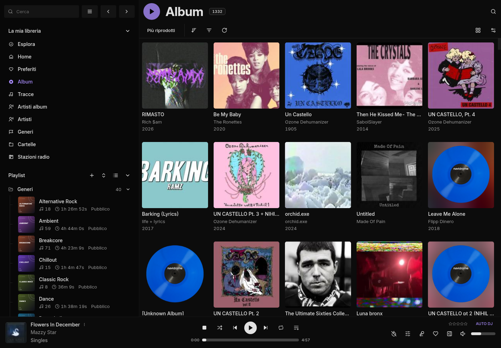
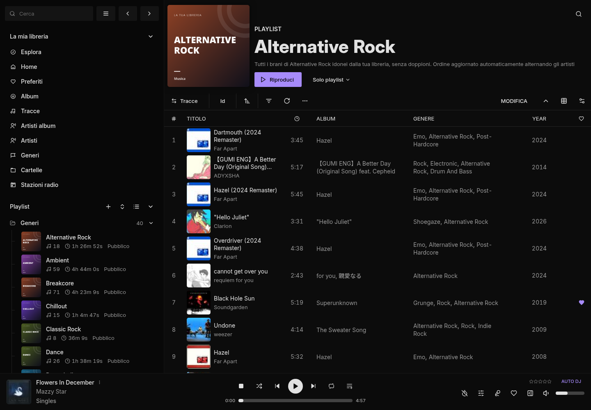
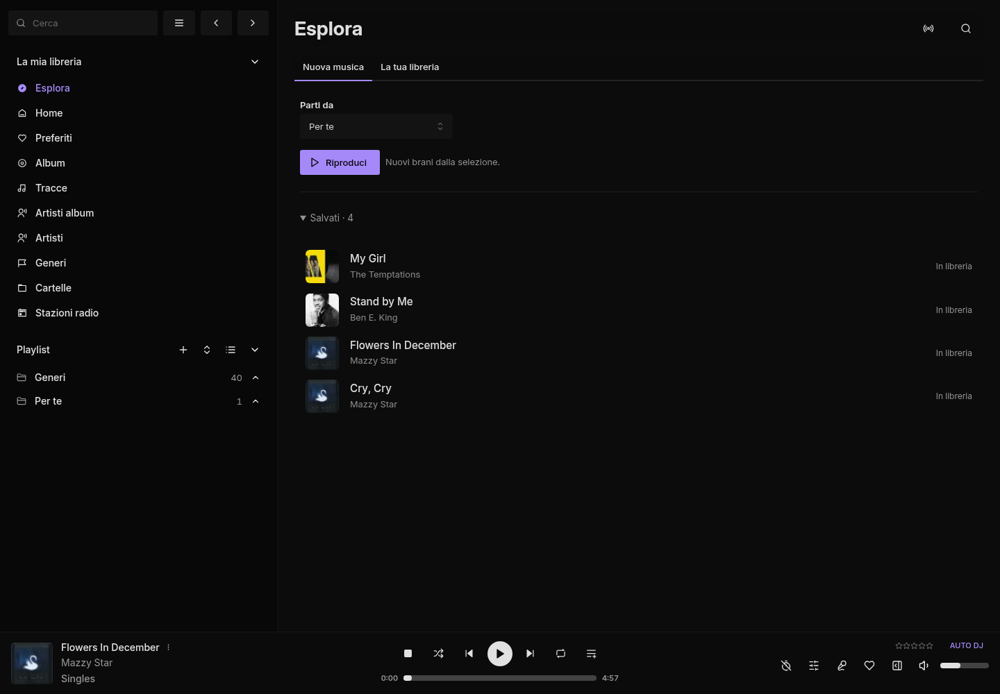
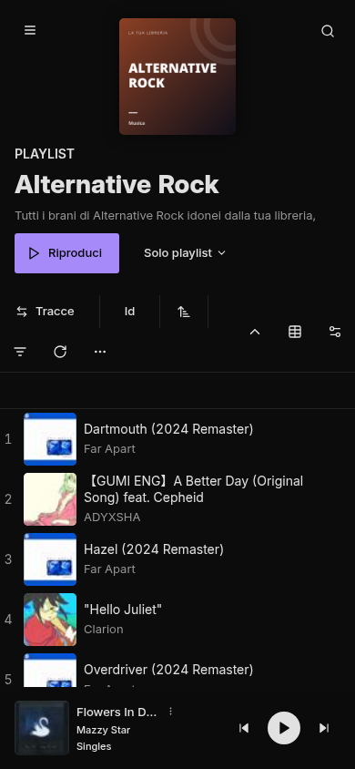
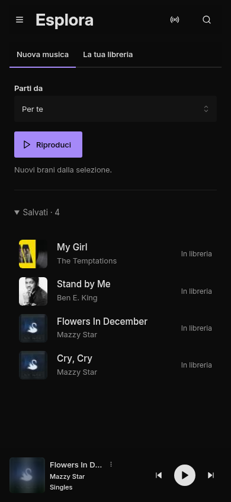

# Musica

A self-hosted music library with discovery radio, built on [Navidrome](https://github.com/navidrome/navidrome) and [Feishin](https://github.com/jeffvli/feishin).

Play your playlists, discover music similar to them, or alternate the two. Save a discovery to download and import it into your own library without stopping playback.



## What it does

- **Only playlist:** plays your tracks in order, then stops. No automatic additions.
- **Only similar:** plays new recommendations based on a playlist, your favourites, or a genre.
- **Playlist + similar:** alternates an owned track and a discovery.
- **Save:** queues the current discovery for download, tagging, duplicate checking and library import.
- Local audio imports, genre playlists and SomaFM live stations.
- A persistent player, violet theme and layouts for desktop and phones.

The discovery controls are currently in Italian. The rest of Feishin retains its language settings. This is a personal, single-user setup made reusable; it is not an official Feishin or Navidrome release.

## Screenshots








Screenshots show a real installation with actual tracks and album artwork. Only screenshots are included; audio files, credentials and databases stay local. Album artwork belongs to its respective rights holders.

For local test fixtures, `uv run python scripts/make-demo-library.py /path/to/an/empty/folder` generates silent audio with fictional metadata.

## Run locally

Linux is the tested host. You need Git, [uv](https://docs.astral.sh/uv/), [Bun](https://bun.sh/), Docker Compose, FFmpeg, Chromaprint (`fpcalc`) and librsvg (`rsvg-convert`).

For example, on Debian/Ubuntu the system packages are:

```sh
sudo apt install git ffmpeg libchromaprint-tools librsvg2-bin
```

1. Clone and create local configuration:

   ```sh
   git clone https://github.com/0xdilo/musica.git
   cd musica
   uv sync --frozen
   uv run python scripts/setup.py --init
   ```

2. Start Navidrome, then open **http://localhost:4533** and create your account:

   ```sh
   PUID="$(id -u)" PGID="$(id -g)" docker compose up -d
   ```

3. Connect that account. The password is prompted, verified and stored in a local file with mode `0600`:

   ```sh
   uv run python scripts/setup.py
   ```

4. Restore the pinned frontend source and build it:

   ```sh
   uv run python scripts/feishin-restore-source.py
   uv run python scripts/feishin-build.py
   ```

   The build runs type checks, lint and tests. It needs several GB of memory.

5. In two terminals, start the player and the background save worker:

   ```sh
   uv run python scripts/run-player.py
   ```

   ```sh
   uv run python -m musica_sync.new_music
   ```

6. Open **http://localhost:9180** and log in with your Navidrome account.

Place music you already have in `music/library/` and scan it in Navidrome, or use the import command below. An empty library can play genre discoveries once Last.fm is configured; recommendations based on favourites or playlists need seed tracks.

### Phone playback

Start playback in the page before locking the phone. System media controls follow the active library track or discovery radio. On iPhone and iPad, playback uses the native audio element, bypassing browser EQ and compression, and requests the playback audio session when supported. Background playback still needs validation on the target phone and browser; desktop emulation cannot confirm lock-screen behavior.

### Enable new-music discovery

Create your own free [Last.fm API key](https://www.last.fm/api/account/create), set `LASTFM_API_KEY` in `.env`, and restart the player and save worker. There is no shared key in the repository.

Discovery uses Last.fm recommendations and yt-dlp to resolve playable recordings. The first uncached track can take several seconds. Temporary audio is prepared during playback; saving creates a permanent library import. Availability depends on the external services and may vary by region. Download only recordings you have permission to use, and follow the source services’ terms.

### Import local files

Set `LOCAL_WATCH_DIRS` in `.env`, or put files in `music/nicotine-inbox/`, then run:

```sh
uv run musica-sync sync-local
```

For an optional YouTube playlist sync, set `YT_PLAYLIST_URL` in `.env` and run `uv run musica-sync sync`. It is not required for local playback or discovery.

### Live radio

Import SomaFM’s official music station catalogue:

```sh
uv run python -m musica_sync.radios
```

This uses the configured Navidrome administrator account. It checks stations before adding them. SomaFM remains the stream provider; consider supporting them directly.

### Optional sonic analysis

Text-based library search and advanced genre curation use a separately installed [AudioMuse-AI](https://github.com/NeptuneHub/AudioMuse-AI) service. Basic playlists, genre/favourite/playlist discovery and saving do not need it. Configure `AUDIOMUSE_URL` in `.env` and `AUDIOMUSE_TOKEN` when running the setup script. The AudioMuse service and models are not bundled.

## Configuration and storage

- `.env`: import settings and your optional Last.fm key.
- `config/feishin.env`: player port, browser-facing Navidrome URL and theme.
- `state/sonic/credentials.json`: local service credentials, created by setup.
- `music/library/`: your music. `data/`: Navidrome and beets databases.
- `config/feishin-source.json`: upstream source revisions. `config/feishin-musica.patch`: frontend changes.

The backend reads the local Navidrome database at `data/navidrome/navidrome.db`; it is intended to run beside the supplied Navidrome installation, not against an unrelated remote server. `NAVIDROME_URL` is the backend-facing URL; `SERVER_URL` in `config/feishin.env` must be reachable by the browser.

The defaults bind to loopback. For access from another device, put the services behind your authenticated private network or HTTPS reverse proxy and adjust the browser URLs. Do not expose the development defaults directly to the internet. Back up your music, databases and local credentials before upgrades.

All runtime folders, cookies, keys and machine-specific configuration are ignored by Git. Do not add them to an issue or pull request.

## Development

```sh
uv run ruff check src scripts tests
uv run python -m unittest discover -s tests
cd vendor/feishin
bun lint
bun test
```

Use Bun for the frontend and uv for Python. Keep frontend edits in the patch so a fresh source restore reproduces them. See [CONTRIBUTING.md](CONTRIBUTING.md).

## Credits and license

Musica includes a patch against Feishin, whose player and interface do most of the frontend work. Navidrome provides the music server; beets, yt-dlp, Last.fm and SomaFM provide other parts of the workflow. Original project notices and dependency licenses are preserved.

Musica’s code and Feishin modifications are distributed under [GPL-3.0](LICENSE). Dependencies and restored upstream sources retain their own licenses. See [THIRD_PARTY_NOTICES.md](THIRD_PARTY_NOTICES.md). No music recordings, service binaries, API keys or trained models are distributed here.
